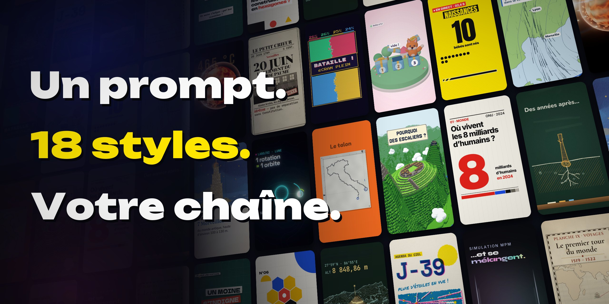

# StudioVisualIdentity

[](LICENSE) [](LICENSE-CONTENT.md) [](https://h4md1.fr/StudioVisualIdentity/) [](https://h4md1.fr/StudioVisualIdentity/)

[](out/demo/demo_16x9.mp4)

**Décrivez votre chaîne à votre agent IA : il vous propose un style parmi 20, ou un mélange (le look d'un style, le mouvement d'un autre), crée votre studio et réalise votre première vidéo.**

Pour les vidéos **verticales (9:16)** seulement : TikTok, Reels, YouTube Shorts, de 10 à 60 secondes (les vidéos d'exemple durent de 12 à 45 s). Le 16:9 et les vidéos au-delà de 60 s ne sont pas couverts.

## En un prompt

Donnez ce texte à votre agent (Claude Code ou un autre agent qui travaille dans un terminal), en remplaçant ce qui est entre crochets :

```text
Clone https://github.com/killerwolf/StudioVisualIdentity et lis son AGENTS.md (il est en anglais, c'est normal).
Ma chaîne : [sujet, ex. quiz de géographie], pour [public, ex. ados de 13 à 17 ans], en [langue].
Propose-moi 3 styles adaptés, ou une combinaison (un look × un mouvement) si elle colle mieux,
avec leurs vidéos d'exemple, et attends mon choix.
Ensuite, crée notre studio avec out/tools/bootstrap_studio.py à partir du style le plus proche,
installe ce qu'il faut, adapte le style à notre chaîne et réalise notre premier épisode sur [sujet de l'épisode].
```

L'agent vous montre 3 propositions, vous choisissez, puis il crée un projet séparé pour votre chaîne (votre style, des modèles de scènes, les outils de rendu) et réalise l'épisode.

**Avant de commencer**, il vous faut :
- un agent IA qui travaille dans un terminal, par exemple [Claude Code](https://claude.com/claude-code) ;
- `git`, Python 3.11 (`uv` conseillé), Node.js, `ffmpeg`, et Chromium via Playwright pour les styles rendus dans un navigateur. Les dépendances sont dans `package.json` et `requirements.txt`, et votre agent peut les installer ;
- une clé [Gemini](https://aistudio.google.com/) pour la voix off. Le quota gratuit permet environ 10 voix par jour, à raison d'un appel par vidéo.

Le dépôt est écrit en français, avec un manuel pour agents (`AGENTS.md`) en anglais.

## Combinez : un look × un mouvement × un format

Chaque style se découpe en trois briques que vous pouvez recombiner :

- **le look** (on dit « habillage ») : couleurs, polices, matière, ce qu'on voit sur une image fixe ;
- **le mouvement** (on dit « mécanique ») : comment le texte arrive, comment la caméra bouge, le rythme ;
- **le format** : durée et son (voix off, ou vidéo muette pour les paroles de chanson).

**Exemple.** Le mouvement de *Lyrics chemin* (le texte s'écrit le long d'un trait que la caméra suit, puis elle recule pour montrer l'image entière) a été habillé avec le look *Grille Suisse* : on obtient « Données qui se tracent », où chaque chiffre s'écrit au-dessus de sa barre ([vidéo](out/shorts/chemin-grille-suisse__geographie__ou-vivent-8-milliards/short.mp4), adoptée). Le même mouvement en *craie verte* donne une recette de quatre-quarts au tableau ([vidéo](out/shorts/chemin-craie-verte__explicatif__le-quatre-quarts/short.mp4), à l'essai).

**Ce qui marche, ce qui ne marche pas.** Un look franc sur un fond plat se transporte bien. Un look dont la signature tient dans le geste lui-même se transporte mal : le plan bleu posé sur le papier découpé ressemblait surtout à du papier, l'essai est abandonné. Aujourd'hui, seuls deux mouvements prennent un nouveau look en un seul fichier : le trait de *Lyrics chemin* et le stop-motion du *Papier découpé*.

En chiffres : 25 looks, 19 mouvements, 4 formats, 29 combinaisons nommées. Les détails (en français) : [`out/report/notes/composition/`](out/report/notes/composition/essais.md).

## La démo (41 s, avec le son)

▶ [16:9](out/demo/demo_16x9.mp4) · [9:16 vertical](out/demo/demo_9x16.mp4)

Les styles prêts à l'emploi, chacun montré par de vraies vidéos d'exemple, et un agent qui crée votre studio et fabrique vos premiers épisodes. La démo a été tournée avant l'ajout des deux styles de paroles : elle en montre 18.

## Ce que vous obtenez

- **20 styles complets** : couleurs, typographies, mouvements, transitions, structure d'une vidéo, sons. Chacun est décrit dans une fiche que votre agent sait lire. Le papier découpé existe en 4 variantes.
- **Des briques à combiner** : chaque style est aussi rangé en look, mouvement et format, pour en créer de nouveaux sans repartir de zéro (voir plus haut).
- **53 vidéos d'exemple** (50 pour les styles, 3 essais de composition), toutes en 1080×1920. Les images et les mouvements sont rendus par du code, sans banque d'images. Les voix off sont générées par Fish Audio (32 vidéos), Gemini (15) et ElevenLabs (3) ; les 3 vidéos de paroles sont muettes (la chanson s'ajoute dans l'appli). Restent quelques éléments de tiers : polices libres, emoji Twemoji, musique d'essai du moteur papier, musique ElevenLabs de la démo. Tout est détaillé dans [`NOTICE.md`](NOTICE.md).
- **Des styles vraiment différents** : un second agent IA, sans contexte, a reçu 72 images anonymes des 18 premiers styles avec la consigne d'en faire 18 groupes de 4. Il les a tous bien regroupés. Protocole et résultats : [`out/report/comparison.md`](out/report/comparison.md) § 4 g.
- **Un studio prêt à produire** : modèles de scènes, rendu image par image, voix off et sons mixés, contrôle qualité.
- **Open source** : le code est sous licence MIT ([`LICENSE`](LICENSE)), le contenu sous CC BY 4.0, avec des exclusions listées dans [`LICENSE-CONTENT.md`](LICENSE-CONTENT.md).

## Ce que ce dépôt fait, et ce qu'il ne fait pas

**Il fait** : choisir un style et le prouver, puis produire des épisodes avec votre agent, un par un.

**Il ne fait pas** la chaîne complète : écriture et validation des sujets, relecture, publication, programmation. Ce dépôt n'est relié à aucun outil de pilotage. Si vous avez déjà votre propre modèle de studio, servez-vous de ce dépôt seulement pour **choisir le style**, puis transposez-le dans votre moteur.

## Les 20 styles

| Style | En une phrase | Sujets des vidéos d'exemple |
|---|---|---|
| [**Grille Suisse**](out/identities/swiss-data/identity.md) | Un chiffre qui claque par écran, posé sur une grille 12 colonnes visible, révélé par des volets rouges nets | événements, géographie |
| [**Gazette 1900**](out/identities/gazette-1900/identity.md) | Chaque grand moment arrive comme la une d'un journal qui tourbillonne, se pose sur la pile et se fait tamponner | événements, histoire |
| [**Arcade Pixel**](out/identities/pixel-arcade/identity.md) | Une vraie simulation physique, déterministe, filmée comme une partie d'arcade | abstrait, quiz et défis |
| [**Brut Mème**](out/identities/brut-meme/identity.md) | Un fait ou un défi par coupe, en lettres géantes qui claquent sur le beat | quiz et défis, événements |
| [**Carte Météo**](out/identities/carte-meteo/identity.md) | Une carte météo claire où les isobares respirent, le vent file et un front balaie l'écran pour changer de plan | événements, géographie |
| [**Bauhaus Cinétique**](out/identities/bauhaus-kinetic/identity.md) | Des formes primaires qui s'emboîtent sur une grille stricte pour expliquer ou défier en 15 secondes | quiz et défis, explicatif |
| [**Tableau Craie**](out/identities/tableau-craie/identity.md) | Un prof bienveillant vous explique le monde en le dessinant à la craie | enfants, explicatif |
| [**Zine Riso**](out/identities/riso-zine/identity.md) | Un chiffre fort, une forme découpée, une annotation au marqueur | événements, géographie |
| [**Trait continu**](out/identities/trait-continu/identity.md) | Un seul trait, jamais levé, dessine l'idée devant vous | enfants, géographie |
| [**Survol pixel**](out/identities/survol-pixel/identity.md) | Chaque sujet devient un petit monde en pixel art 16 bits que la caméra survole, puis frôle jusqu'à l'horizon | explicatif, histoire |
| [**Diorama Pastel**](out/identities/pastel-diorama/identity.md) | Un monde de jouets doux pour les 6–10 ans, où chaque idée « saute » en place avec un rebond | enfants, quiz et défis |
| [**Relief Topo**](out/identities/topo-relief/identity.md) | Chaque sujet devient un terrain qu'on survole | géographie, histoire |
| [**Atlas Gravé**](out/identities/atlas-grave/identity.md) | Un savoir qui s'imprime à l'encre sur une carte gravée, et finit sur une question ouverte | géographie, histoire |
| [**Aquarelle Conte**](out/identities/aquarelle-conte/identity.md) | Chaque short est une page d'album | enfants, histoire |
| [**Labo Néon**](out/identities/neon-lab/identity.md) | Une nuit de laboratoire où la science se voit en lumière | abstrait, explicatif |
| [**Cosmos Doc**](out/identities/cosmos-doc/identity.md) | Un plan de cinéma sur un vrai objet du ciel, où un seul chiffre suffit à donner le vertige | événements, explicatif |
| [**Chrome Liquide**](out/identities/liquid-chrome/identity.md) | Une matière liquide, chromée et hypnotique qu'on regarde couler jusqu'au bout | abstrait, quiz et défis |
| [**Papier découpé (+ 3 variantes)**](out/identities/papier-decoupe/identity.md) | Chaque idée est une pièce de papier découpée qui saute sur un tapis de découpe vert, en stop-motion | explicatif, histoire |
| [**Lyrics chemin**](out/identities/lyrics-chemin/identity.md) | Le texte s'écrit le long d'un trait que la caméra suit, puis elle recule et l'image entière apparaît : la route de Magellan, une recette de gâteau | histoire, explicatif, paroles de chanson |
| [**Lyrics punchy**](out/identities/lyrics-punchy/identity.md) | Les paroles d'une chanson tombent pile sur le temps et s'empilent en mur, avec un petit carton illustré | paroles de chanson (vidéo muette : la chanson s'ajoute dans l'appli) |

Vue d'ensemble : [`out/report/directions-contact-sheet.jpg`](out/report/directions-contact-sheet.jpg). Chaque style a sa planche dans `out/identities/<id>/contact-sheet.jpg`.

## Ce que vous devrez faire ou valider

- **Valider le style** proposé par l'agent (nom, couleurs, ton) avant de produire en série.
- **Fournir une clé de voix** : `GEMINI_API_KEY` (la recette utilisée ici est dans [`out/report/notes/voix-lot2.md`](out/report/notes/voix-lot2.md)) ou Fish Audio. Ajoutez `FREESOUND_API_KEY` si vous voulez d'autres bruitages que ceux fournis.
- **Regarder et écouter chaque épisode** avant de le publier. L'agent mesure les niveaux sonores, mais il ne peut pas écouter.
- **Relire les faits** énoncés dans chaque épisode.

## Pour aller plus loin

- [`AGENTS.md`](AGENTS.md) : le guide détaillé pour les agents (en anglais).
- [`out/identities/index.json`](out/identities/index.json) : les 20 styles et leurs briques en données (couleurs, polices, public conseillé, coût de rendu, combinaisons testées).
- [`out/report/`](out/report/README.md) : le rapport complet de l'exploration, comparaisons et tests à l'aveugle compris.
- **Créer de nouveaux styles** : le skill Claude Code `fabrique-identites` (`.claude/skills/fabrique-identites/`) les fait fabriquer par des sous-agents, à partir du [catalogue des librairies](out/library-cards/catalogue.md).
- **Sound design** : le skill [`sound-design`](https://github.com/killerwolf/skills/tree/main/skills/sound-design) du plugin `studio` (`claude plugin marketplace add killerwolf/skills` puis `claude plugin install studio@killerwolf`).
- [`out/demo/`](out/demo/README.md) : comment la vidéo démo est fabriquée.
