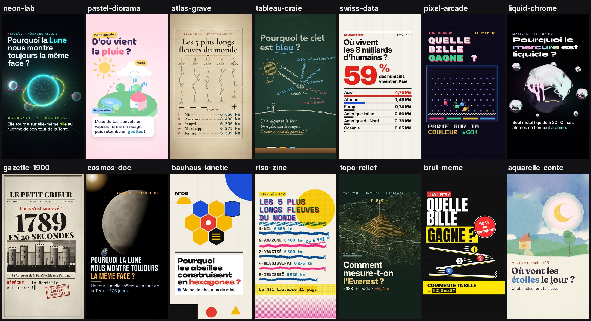

# StudioVisualIdentity

**Un catalogue de 14 styles visuels prêts à l'emploi pour lancer une chaîne de vidéos courtes verticales (TikTok, Reels, Shorts).**
Chaque style est prouvé par de vraies vidéos (31 au total, avec voix off), et le dépôt contient les outils pour en produire de nouvelles.



## Comment s'en servir

Donnez ce prompt à votre agent (Claude Code, etc.) en remplaçant ce qui est entre crochets :

```text
Lis AGENTS.md de https://github.com/killerwolf/StudioVisualIdentity.
Choisis le style qui convient à une chaîne de [sujet, ex. quiz de géographie] pour [public, ex. ados de 13 à 17 ans] en [langue].
Crée notre studio avec out/tools/bootstrap_studio.py, adapte l'identité visuelle à notre chaîne,
puis réalise notre premier épisode sur [sujet de l'épisode] et montre-moi le résultat.
```

L'agent choisit un style, crée un projet séparé pour votre chaîne (votre identité visuelle, des modèles de scènes, les outils de rendu), puis fabrique les épisodes un par un.

## Ce que vous devrez faire ou valider

- **Valider l'identité** proposée par l'agent (nom, couleurs, ton) avant de produire en série.
- **La voix off** : la génération de l'audio (Fish Audio) n'est pas automatique ; l'agent mixe ensuite les fichiers.
- **Relire les faits** énoncés dans chaque épisode.

## Pour aller plus loin

- [`AGENTS.md`](AGENTS.md) : le guide détaillé pour les agents (en anglais).
- [`out/identities/index.json`](out/identities/index.json) : les 14 styles en données (couleurs, polices, public conseillé).
- [`out/report/`](out/report/README.md) : le rapport complet de l'exploration (en français).
