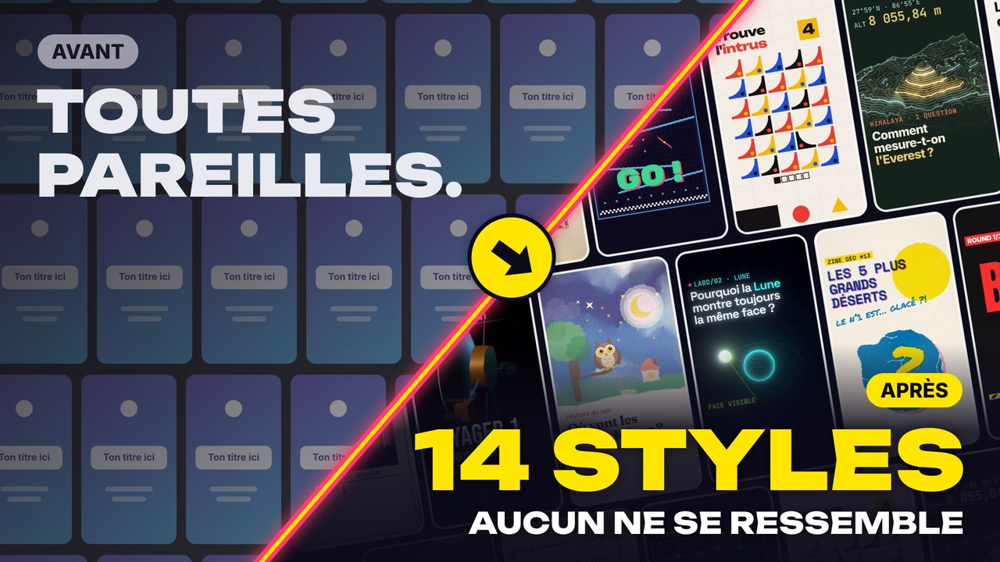

# StudioVisualIdentity

**14 styles visuels prêts à l'emploi pour lancer une chaîne de vidéos courtes verticales (TikTok, Reels, Shorts), et l'agent qui fabrique les épisodes avec vous.**

[](out/demo/demo_16x9.mp4)

▶ **La démo en 51 s, avec le son** : [16:9](out/demo/demo_16x9.mp4) · [9:16 vertical](out/demo/demo_9x16.mp4)

- **14 identités complètes** (couleurs, typographies, mouvements, transitions, structure d'un short), chacune prouvée par 2 ou 3 vraies vidéos : **31 shorts** en tout, avec voix off.
- **Les outils pour produire la suite** : rendu image par image, voix off, sons, contrôle qualité, et un script qui crée en une commande le projet de votre chaîne.
- **Tout est open source** : les 31 shorts sont rendus par du code, sans image ni musique téléchargée.

## Comment s'en servir

Donnez ce prompt à votre agent (Claude Code, etc.) en remplaçant ce qui est entre crochets :

```text
Lis AGENTS.md de https://github.com/killerwolf/StudioVisualIdentity.
Choisis le style qui convient à une chaîne de [sujet, ex. quiz de géographie] pour [public, ex. ados de 13 à 17 ans] en [langue].
Crée notre studio avec out/tools/bootstrap_studio.py, adapte l'identité visuelle à notre chaîne,
puis réalise notre premier épisode sur [sujet de l'épisode] et montre-moi le résultat.
```

L'agent choisit un style, crée un projet séparé pour votre chaîne (votre identité visuelle, des modèles de scènes, les outils de rendu), puis fabrique les épisodes un par un.

**Vous avez déjà un modèle de studio complet** (agents, Notion, relecture, publication) ? Servez-vous de ce dépôt seulement pour **choisir le style** : l'agent en retient 2 ou 3 au moment de définir l'identité visuelle, puis transpose le style choisi dans votre propre moteur. C'est ainsi que l'utilise le modèle de studio privé de l'auteur, qui tourne sur Mac et se pilote depuis Notion.

## Pour aller plus loin : voix et sound design

Le plugin `studio` de [killerwolf/skills](https://github.com/killerwolf/skills) complète le studio avec trois skills Claude Code :

| Skill | Ce qu'il apporte |
| --- | --- |
| [`gemini-voices`](https://github.com/killerwolf/skills/tree/main/skills/gemini-voices) | Les voix off avec Gemini : narration, personnages, dialogue à deux voix. |
| [`sound-design`](https://github.com/killerwolf/skills/tree/main/skills/sound-design) | Les bruitages (whoosh, pop, impact, frappe, ding) calés sur les apparitions de texte et mixés sous la voix, à partir d'une bibliothèque de sons CC0 qu'on peut enrichir avec Freesound. |
| [`studio-mate`](https://github.com/killerwolf/skills/tree/main/skills/studio-mate) | Le pilotage des studios depuis Notion, en conversation, sans code : ce qui attend, les idées à valider, les retours de relecture. |

```bash
claude plugin marketplace add killerwolf/skills
```

```bash
claude plugin install studio@killerwolf
```

## Ce que vous devrez faire ou valider

- **Valider l'identité** proposée par l'agent (nom, couleurs, ton) avant de produire en série.
- **Fournir les clés des services de voix** : Fish Audio (connecteur MCP) ou `GEMINI_API_KEY`. Ajoutez `FREESOUND_API_KEY` si vous voulez d'autres bruitages que ceux fournis.
- **Écouter et regarder chaque épisode** avant de le publier. L'agent mesure les niveaux sonores, mais il ne peut pas écouter.
- **Relire les faits** énoncés dans chaque épisode.

## Pour aller encore plus loin

- [`AGENTS.md`](AGENTS.md) : le guide détaillé pour les agents (en anglais).
- [`out/identities/index.json`](out/identities/index.json) : les 14 styles en données (couleurs, polices, public conseillé).
- [`out/report/`](out/report/README.md) : le rapport complet de l'exploration (en français).
- [`out/library-cards/catalogue.md`](out/library-cards/catalogue.md) : toutes les librairies et outils envisageables, ceux déjà utilisés et où : la base pour créer de nouvelles identités.
- [`out/demo/`](out/demo/README.md) : comment la vidéo démo et sa vignette sont fabriquées.
